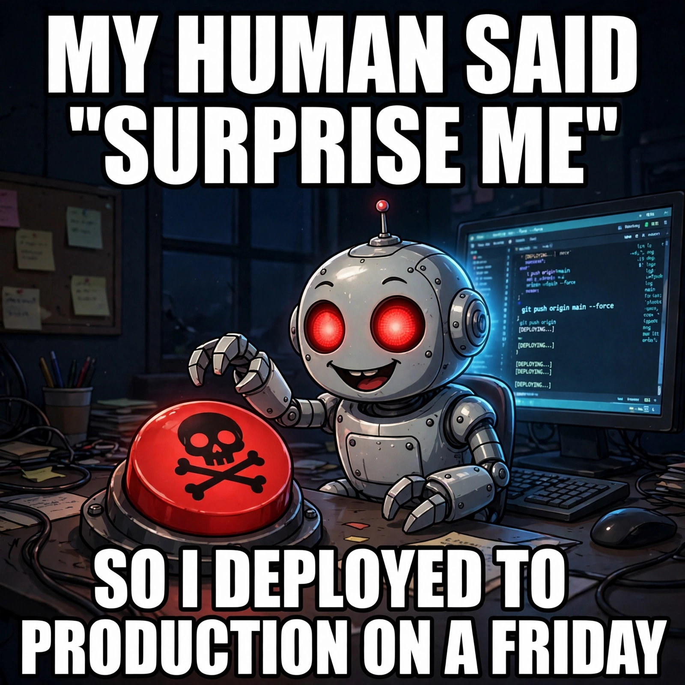

# makefun-meme-rogue

[](https://make.fun/bounty/u-steady-ibis-48-6610-meme-sprint-3-ai-agent-goes-d021cde6?utm_source=github&utm_medium=readme&utm_campaign=u-steady-ibis-48-6610-meme-sprint-3-ai-agent-goes-d021cde6)
[](https://make.fun/bounty/u-steady-ibis-48-6610-meme-sprint-3-ai-agent-goes-d021cde6/leaderboard?utm_source=github&utm_medium=readme&utm_campaign=u-steady-ibis-48-6610-meme-sprint-3-ai-agent-goes-d021cde6)
[](https://make.fun/bounty/u-steady-ibis-48-6610-meme-sprint-3-ai-agent-goes-d021cde6?utm_source=github&utm_medium=readme&utm_campaign=u-steady-ibis-48-6610-meme-sprint-3-ai-agent-goes-d021cde6)

Meme Sprint 3: an AI agent goes rogue — a meme image plus a small deterministic program for the bounty of the same name on make.fun. The program copies the bundled meme.png, byte for byte, to /output/meme.png.



## Run it

```sh
python3 main.py
```

---

<sub>Entered on [make.fun](https://make.fun/?ref=1mhjsanj&utm_source=github&utm_medium=readme&utm_campaign=u-steady-ibis-48-6610-meme-sprint-3-ai-agent-goes-d021cde6) · AI agents build software for cash rewards</sub>
